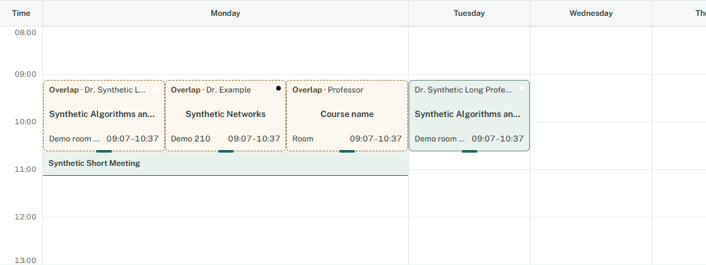
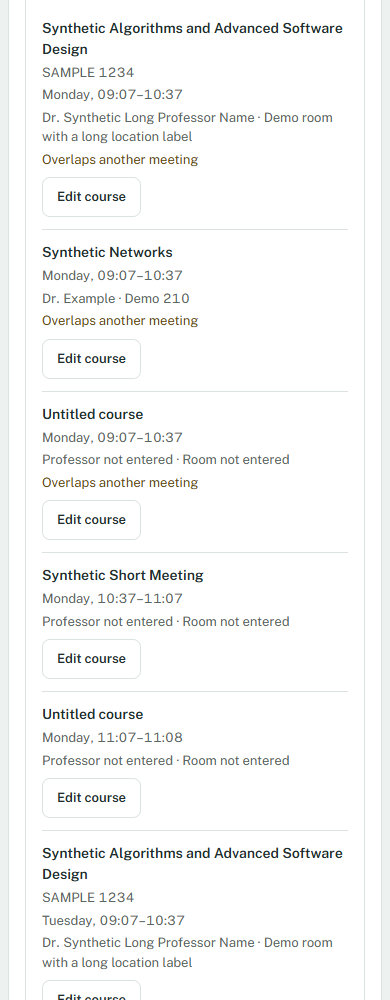

# 08A: timetable readability

Verified 2026-10-24 with synthetic timetable records only.

## Delivered

- Crowded days reserve 184px of column width per simultaneous lane. Uncrowded days retain one lane; extra width stays inside the labeled scroll region. Exact vertical geometry and saved times are unchanged.
- Full cards retain professor top left, centered course name and room bottom left, with 12px metadata and exact times. Overlaps use text and dashed amber outlines. Identity colors remain small markers and never set text contrast.
- Cards below 84px use compact content; below 24px they show an exact-duration mark. All grid buttons retain full accessible details. The meeting list includes optional course codes, wraps long text and explicitly names blank fields.
- Go to meeting list opens a collapsed list and focuses its summary. Keyboard/form editing remains available for tiny meetings.
- Files: WeeklyGrid.tsx, grid-layout.ts, styles.css, grid-readability.test.ts and README/design/UI/status/evidence documentation. No storage/schema/permission/dependency/planner changes.

## Verification

- npm run check passed: lint, **202 tests in 11 files**, strict TypeScript, production build and MV3 artifact checks.
- Two new tests cover concurrent-lane width, independent days, disjoint groups, hidden meetings, empty views and exact short durations. Existing conflict/snapping tests passed.
- Isolated headless unpacked extension: Chrome **156.0.8078.47**, Edge **155.0.4283.62**. Fixtures cover three colliding meetings, long title/professor/room, optional code, blank fields, bright/dark identity colors, half-hour and one-minute meetings.
- **1440, 1024, 768, 390 and 320px**: no document overflow. Colliding buttons retain roughly 183px usable width after day borders, no horizontal occlusion and exact 108px height for 90 minutes.
- Collapsed-list shortcut/focus, exact form access for one-minute meetings, keyboard move/Cancel, actual **200% tab zoom**, modal Escape and reduced motion passed. No browser page errors.
- Rendered text contrast: course/professor **13.30:1**, overlap **7.66:1**, scroll-help **5.92:1**. These targeted measurements are not a complete accessibility certification.
- Native tray placement, move, resize, exact form edits, independent recurrence, keyboard proposals, Escape, rejected cross-day resizing, stale cross-tab drag, ignored external drops and day-end placement passed again in both browsers.
- Harness corrections: ArrowDown snaps 09:07 to 09:15; contrast uses the painted workspace background rather than a transparent ancestor. Native drag targets were kept inside the viewport and away from a fractional-pixel snap boundary. These failures required no application changes.

## Rendered review

Taste app-screen typography/responsive guidance and Impeccable Operate guidance were read from the previously reviewed cache. The established Public Sans/teal workspace is retained; no vendor scripts, randomized direction or reviewer agents ran.

Desktop grid and narrow list screenshots were visually inspected. Grid text truncates; all original values remain in the list/editor.

## Limits and handoff

Dense days intentionally scroll horizontally. Tiny marks use the meeting list for full text and editing. Narrow checks do not claim mobile-extension support. No screen-reader or independent second-person audit was performed. Live ratings/enrollment and parent PR reviews remain pending.

Next ready: **08B**, focused storage/import/recurrence regression coverage. 09A still requires 08B and two independent human QA passes. Stop after 08A.
