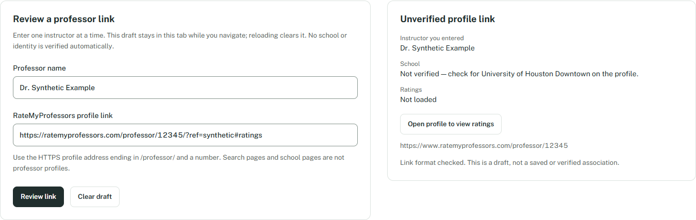
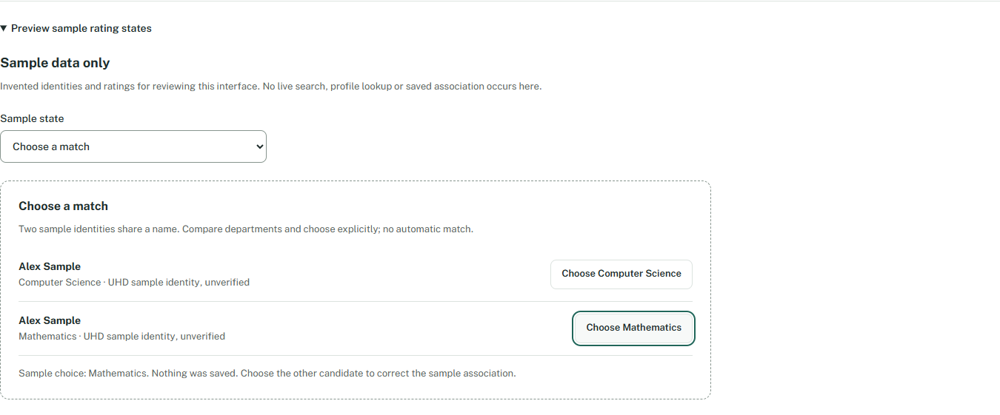
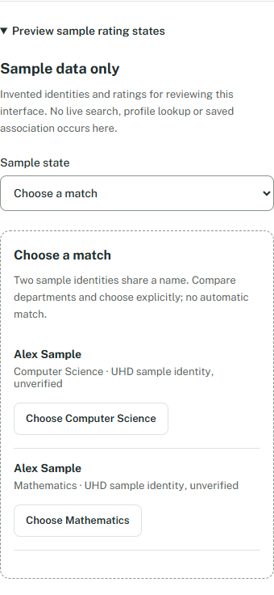

# 10A: Professors preview

Implemented 2026-10-24; handoff finalized 2026-10-25. Scope: Professors UI and profile association editor preview, dependent on completed 04A/02A. No live RMP completion is claimed.

## Behavior

- The Professors destination now accepts one instructor name and an RMP profile link. Review link validates and canonicalizes the URL, then focuses an explicitly unverified preview. Staff/TBA and invalid names/links show focused field errors.
- Only HTTPS RMP professor paths are accepted, without credentials or nondefault ports. Query/fragment data are removed. Format validation does not verify existence, UHD school membership or instructor identity.
- Open profile to view ratings is an explicit native link in a separate tab with noopener/noreferrer. There is no background provider request.
- Changes invalidate the reviewed preview. Clear draft restores name-field focus. Drafts survive route navigation but clear on reload; no associations or samples are saved.
- An opt-in Sample data disclosure demonstrates unavailable, loading, available, ambiguous, no-match, no-reviews and stale states. All identities, counts, ratings and dates there are synthetic. No reviews displays Not rated rather than 0/5. Ambiguous candidates require explicit choice and allow correction; changing scenarios resets that choice.

## Files and boundaries

New Professors.tsx implements the UI; professor-preview.ts owns the session model and validation. App.tsx retains that state across routes. styles.css extends the existing design. professor-preview.test.ts adds 25 URL/name boundary tests. No dependencies, permissions, portal selectors, storage schemas or planner files changed.

ProfileLinkDraft intentionally does not satisfy ProfessorAssociation: school identity and persistence are absent. Provider/cache work belongs to 10B, matching to 11B and persistent correction wiring to 12A. Existing provider RPCs remain unavailable.

## Validation

The final npm run check passed: lint without warnings, 242 tests across 13 files, strict TypeScript, production build and MV3 artifact validation. These checks ran after the sample selector received an explicit accessible label. No production code changed afterward.

Automated unpacked-extension checks passed in isolated synthetic profiles on Chrome 156.0.8078.47 and Edge 155.0.4283.62. See [Chrome report](10a-chrome-report.json) and [Edge report](10a-msedge-report.json). Both report ok=true and no errors.

Both browsers checked focused invalid forms; canonical unverified review; route preservation; keyboard profile navigation; all seven sample states; explicit ambiguous choice/correction; literal and long text; widths 1440/1024/768/390/320; actual 200% tab zoom; clear/reload behavior; unchanged local storage; and no background provider requests. The explicit external link target was intercepted with synthetic HTML, so this is navigation verification, not live RMP availability verification.

Desktop editor, ambiguous candidate and narrow screenshots were visually inspected for readable labels, truthful states and usable layout. This is automated browser QA plus agent visual inspection, not a screen-reader audit or either human's 09A acceptance. Taste app-screen form/settings and Impeccable Operate guidance were reused; no vendor toolkit was executed.

## Outcome and next task

10A's UI acceptance is complete. Live UHD search/ratings, verified identities, saved associations and real portal integration remain unavailable. 09A still needs both independent human sign-offs using its existing checklist; no release or merge is implied. Next ready A task: 11A, an accessible inline badge and profile navigation exercised in a synthetic fixture without altering checkbox/submit behavior. B's 01B assignment remains unchanged.
