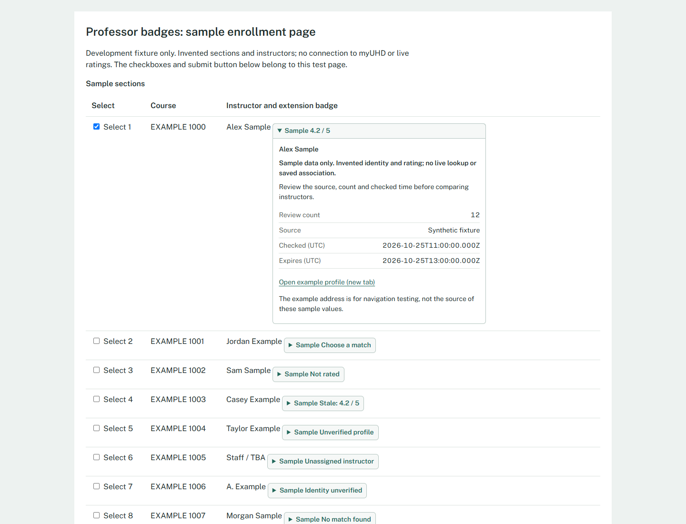
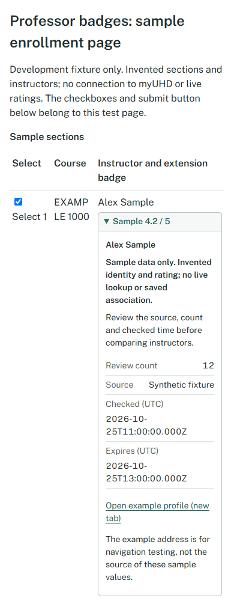

# 11A: Inline professor badges

Completed 2026-10-25 on feat/11a-professor-badges, based on 10A/PR #9. Acceptance: an accessible badge and profile navigation in a synthetic page without altering checkbox/submit behavior. This is a reusable component and fixture, not live myUHD integration.

## Implementation

- ProfessorBadge uses a native details/summary disclosure beside instructor text. Collapsed text includes the result state and a Sample prefix for synthetic data. Expanded details show instructor, explanation, review count, provenance and UTC checked/expiry times when available. Details occupy document flow and do not cover controls.
- Tab, Enter and Space use native disclosure behavior. Escape closes details and returns focus to the summary. Explicit source links use canonical HTTPS RMP profile URLs, a new tab and noopener/noreferrer.
- Click and keyboard bubbling from the badge is stopped to isolate the fixture's delegated row-selection listener. No checkbox, enrollment button, portal query, submit callback or network request exists in the component.
- Unverified identity suppresses numeric snapshots and source navigation. Ambiguous data never picks a candidate. Staff/TBA uses an unassigned state; missing ratings read Not rated, zero reviews remain zero, and stale results carry an explicit label. Invalid URLs, conflicting IDs, impossible scores/counts and invalid timestamps yield Ratings unavailable.
- A link-only state offers an explicitly unverified profile link. Synthetic example links are labeled navigation examples, not sources of sample values. Source URL parsing is shared with 10A without changing its behavior.
- Styles are scoped beneath uhdx-professor. No portal/global CSS rules, new dependencies, permissions, content scripts, production entrypoints or storage schemas were added. Tests/fixtures is not included in dist; live placement/matching remains 11B/12A work.

## Validation

Final npm run check passed: lint, **266 tests in 14 files**, strict TypeScript, production build and MV3 artifact checks. The 24 new unit cases cover identity/source/data boundaries and escaped markup/native semantics. TypeScript initially caught a combined status union that did not narrow; splitting its variants fixed it before the passing run.

The committed browser runner passed against the synthetic Vite fixture in Chrome 156.0.8078.47 and Edge 155.0.4283.62. Reports: [Chrome](11a-chrome-report.json), [Edge](11a-msedge-report.json).

Both browsers verified:

- Tab/Enter/Space/Escape, focus restoration, detail clicks and explicit source navigation.
- Eleven examples spanning numeric, ambiguous, no-review, stale, link-only, unassigned, unverified, no-match, loading, unavailable and invalid-link/long-literal-text states.
- Badge interactions retain selected boxes and cause zero submissions; original checkbox/button nodes and attributes remain unchanged. Original delegated row selection and checkbox labels still work. Only explicit submit increments the synthetic counter, exactly once.
- The explicit source link opens a canonical address with no opener; the request is intercepted with synthetic HTML. No live profile fetch or provider background request is claimed.
- Widths 1440/1024/768/390/320, 200% text enlargement and reduced motion have no document overflow. Text enlargement is not a full browser-zoom test.

Desktop and narrow screenshots were visually inspected. Source/count/freshness details remain readable and course controls remain separate. No screen-reader audit, real portal event compatibility, live RMP availability or human 09A sign-off is implied. Taste app-screen and Impeccable Operate/craft guidance informed this extension of the existing design; no vendor toolkit ran.

## Reproduce

Run npm ci and npm run check with the pinned Node/npm versions. For manual review, run npm run dev and open /tests/fixtures/professor-badges.html on its printed localhost URL. Every course/instructor/result is invented; Submit sample selection only updates a local text counter.

The automated runner is tests/browser/professor-badges.mjs. It starts/stops its own local Vite server and writes reports/screenshots under ignored .local/qa. With Playwright available to Node and Chrome/Edge installed, run:

~~~sh
node tests/browser/professor-badges.mjs chrome
node tests/browser/professor-badges.mjs msedge
~~~

If Playwright is installed outside the project, set PLAYWRIGHT_MODULE_PATH to that module directory before running. It is a test-runner prerequisite, not an extension dependency; no automated dependency install occurs.

## Handoff

11A fixture acceptance is complete. Production badges still require observed portal mounting/identity matching (11B), persistent correction (12A) and observer/cache work (12B). Snapshot expiry is checked when rendered; this component does not refresh or schedule invalidation. Future adapters must mount outside labels/buttons and verify the real event model; this fixture cannot prove unknown portal capture handlers or rerenders safe.

Next ready project task: **01B**, owned by the teammate, the observed/anonymized portal map. A's 12A is blocked on 11B; 09A remains pending both independent human QA results. No merge, release or enrollment execution is included.
